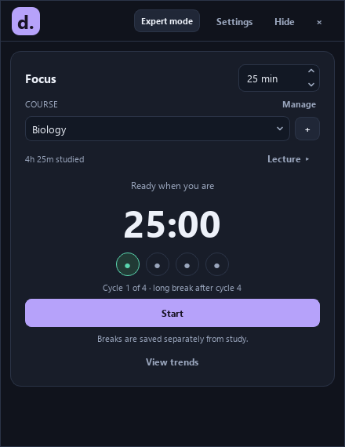
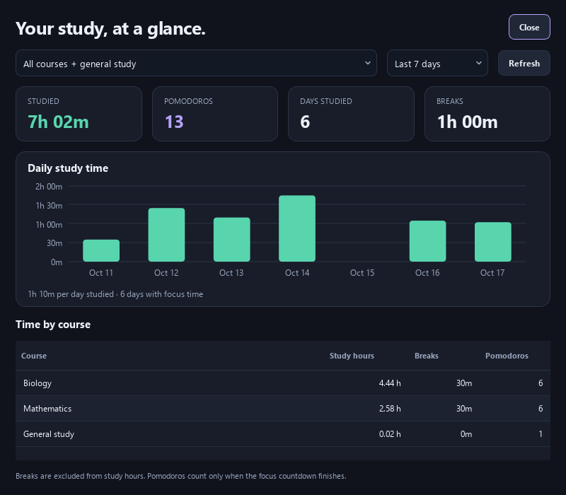

# Decipline

A local Windows study app: choose a course, start a Pomodoro, and see where your study hours went. It also supports daily and weekly schedules in Expert mode.

## Watch Decipline in action

A 60-second tour of course and lecture tracking, Pomodoro cycles, separate breaks, Expert schedules, study Trends, and customizable AI prompts.

https://github.com/user-attachments/assets/1be4c680-fd23-413f-861b-75337bd8fcf6

[Watch or download the full showcase (1080p MP4)](assets/showcase/Decipline-Showcase.mp4)

*Uses sample data. Timer sequences are accelerated.*



## Start studying

1. Open `dist\Decipline\Decipline.exe`. Keep its whole folder together; Python, an AI account, and a network connection are not required for studying or viewing Trends.
2. Choose **Basic** during setup for the compact interface. You can switch between Basic and Expert in **Settings**.
3. Select a saved course or use **+** to add one. **General study** works without creating a course. Expand **Lecture** only if you want to attach the session to a particular lecture.
4. Set the focus minutes and press **Start**. **Pause / Resume** excludes paused time. **Stop & save** keeps partial progress.

Basic opens at 440 × 570. Expert includes the schedule table, schedule library, AI prompt tools, and advanced settings. Both interfaces use the same timer and course selection; switching interfaces keeps your current session running.

Use **Expert mode / Basic mode** in the top bar to switch immediately. The current Pomodoro keeps its original course or schedule task while you switch views.

In Expert, the **Course path** checkbox chooses what the next Pomodoro tracks. Checked uses the course and optional lecture picker. Unchecked follows the current unfinished schedule task. Finishing the full focus countdown marks that task green and advances to the next unfinished task; breaks, pauses, and partial sessions do not complete tasks. Changing this checkbox saves the current partial session and prepares the other path; press Start when ready. Your Expert path choice is remembered. New Basic sessions always use course tracking.

Schedule focus stays attached to its original task if you change the viewed routine or weekday. Renaming or moving that task preserves the link. Removing it skips completion without changing another task. Manual completion during focus also avoids completing the next task twice.

Use **Manage** beside the course heading to add, view, rename, remove, or restore courses and lectures. Renaming keeps the same history. Removing hides an item from the timer; its recorded hours remain in Trends. Enable **Show removed items** to restore it. The course or lecture of an active session can be renamed; stop and save before removing it. Empty removed items are omitted from Trends.

**Hide** sends the window to the system tray and keeps the timer running. Click the Decipline tray icon or choose **Open Decipline** from its menu to return. **× / Close app** saves progress and exits completely. Both choices are available in Basic and Expert; the tray menu also includes **Close app**.

## Cycles and breaks

The four dots select Pomodoro cycles 1–4. Selecting a dot saves any partial progress and prepares a fresh focus session in that slot. A dot selection does not create study time or a completed Pomodoro.

After a focus countdown finishes, press **Start break**. Cycle 4 gets the configured long break. **Take a break** during focus preserves the unfinished focus countdown; **End break**, then **Resume**, returns to it. A break that finishes naturally also leaves the next study session ready for you to start.

Focus time, break time, course/lecture attribution, and completed Pomodoros are stored locally. Breaks never count toward study hours or study streaks. Closing the app saves recorded progress. After an interruption, only previously saved time is retained; time while the app was closed is never added.

## Trends



**View trends** shows actual study time, completed Pomodoros, days studied, and breaks for Today, 7 days, 30 days, 365 days, or All time. The native chart uses daily, weekly, monthly, or yearly bars as appropriate. Hover a bar for its recorded duration.

The course table shows study hours, separate breaks, and completed Pomodoros. Select a course to see its lecture breakdown. Existing lecture history is preserved. Older undated study remains in All time totals and is identified separately; it does not inflate daily averages. Only a finished focus countdown counts as a completed Pomodoro.

## Schedules and copied AI prompts

Expert mode includes a schedule library, manual daily/weekly editing, and JSON import. These tools are optional; courses and timers work independently of schedules.

The schedule library supports Create, Rename, Delete, and **Edit tasks**. The task editor supports Add, Edit, Delete, and moving tasks up/down, separately for each weekday. Task edits preserve completion state; moving or deleting tasks keeps the active-task position consistent. Library changes are saved atomically, and failed writes report an error while keeping the previously saved data.

In **Schedule library → Edit prompts**, customize daily and weekly instructions and choose **Save prompts**. **Copy prompt** uses your saved instructions for the selected library tab. **Restore default for this tab** edits the draft; save to apply it. Cancel leaves saved prompts unchanged. Telegram notifications are optional and configured in Expert settings.

## Source and builds

Install dependencies with `python -m pip install -r requirements.txt`, then run `python main.py` or `run.bat`. Run `build.bat` to check the source, build the standalone Windows folder, and smoke-test it. Set `DECIPLINE_BUNDLE_NAME` to a different folder name to build alongside another copy. Quit an older copy before opening the new executable.

Existing schedules, settings, and statistics beside the older `dist\Decipline.exe` are detected automatically. Source runs detect that data when the project root has no schedule library. Set `DECIPLINE_DATA_DIR` to an existing directory for isolated data.

The timer reuses one interruptible worker, uses monotonic deadlines, and saves statistics atomically every 15 seconds and at session boundaries, pause, and exit. A forced process kill can lose recent progress since the last save. Schedule tables update changed rows without rebuilding every cell. Trends uses native Qt drawing, with no plotting dependency.

Validation commands:

```powershell
python -m unittest discover -s tests -v
python tests/render_ui.py
python tests/benchmark_performance.py --baseline 5f439ef
dist\Decipline\Decipline.exe --smoke-test
```

Tests, rendered samples, benchmarks, and the smoke test use temporary data. Screens render to `build/ui-review-current`. See [PERFORMANCE.md](PERFORMANCE.md) for measurements and review coverage.
